# Transformer in JAX

An implementation of the encoder-decoder Transformer from
[Attention Is All You Need](https://arxiv.org/abs/1706.03762) (Vaswani et al., 2017), written in JAX
without a neural network library. It includes scripts that plot each step of the model, a set of
correctness checks, and a training script for Karpathy's
[Tiny Shakespeare](https://github.com/karpathy/char-rnn/tree/master/data/tinyshakespeare) dataset.

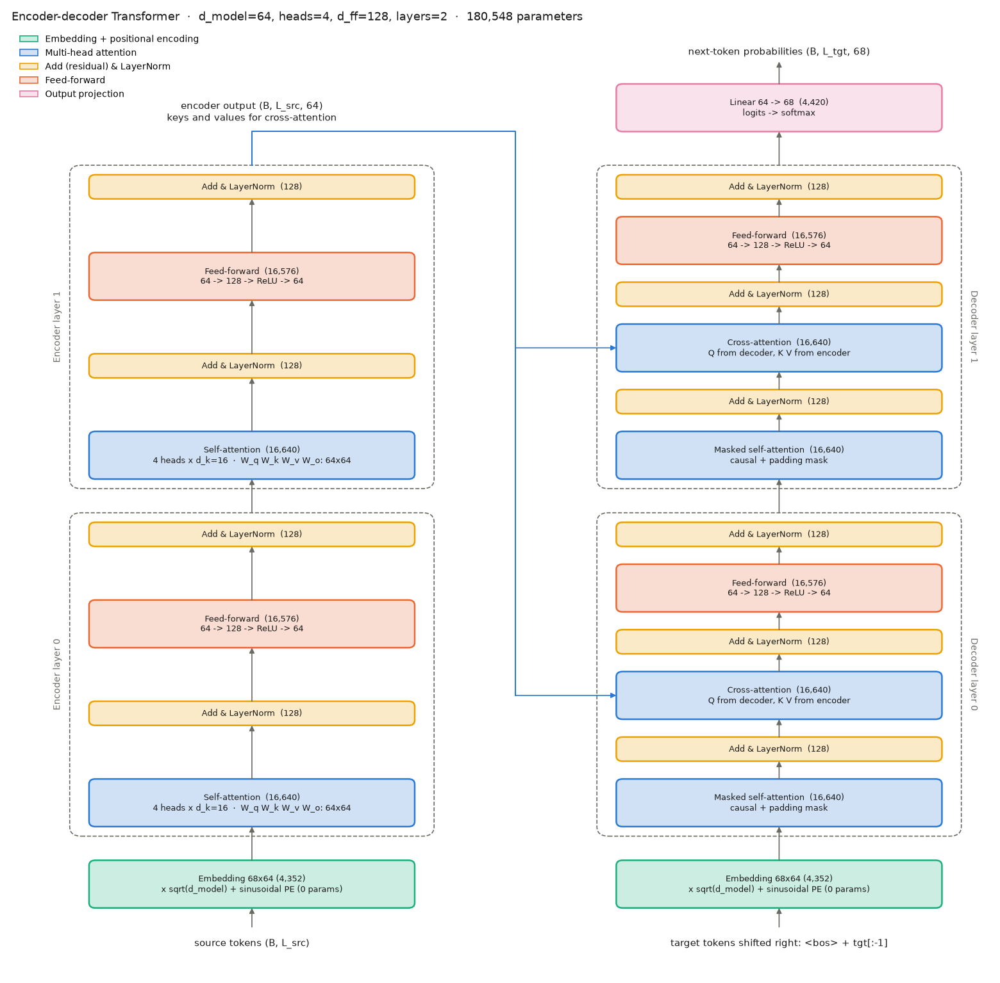

## Setup

Dependencies are managed with [uv](https://docs.astral.sh/uv/) and pinned in `uv.lock`.

```bash
uv sync                          # CPU version of JAX
uv run visualize_encoder.py      # figures 01-06
uv run visualize_transformer.py  # figures 07-12
uv run dummy_run.py --quick      # correctness checks only (about 1 min on CPU)
uv run dummy_run.py              # checks and a short training run (about 13 min on CPU)
uv run train.py                  # training, writes checkpoints/shakespeare/
uv run generate.py               # text generation from a checkpoint
```

On first use, `data.py` downloads the dataset from Karpathy's repository to `data/input.txt`. The file is
checked against its expected size (1,115,394 bytes) and MD5 (`6fb458f1232090904fb40fe944165e91`) each
time it is loaded.

## Training on a GPU

JAX uses a GPU if one is available. On Linux with an NVIDIA GPU, install the CUDA version of JAX with the
`cuda` extra:

```bash
uv sync --extra cuda
uv run python -c "import jax; print(jax.devices())"   # lists CudaDevice if the GPU is found
uv run train.py
```

Default options of `train.py` (see `uv run train.py --help`):

| Option | Default | Description |
|---|---|---|
| `--tokenizer` | `char` | `char`, `bpe` (size set by `--bpe-vocab`) or `byte` |
| `--block` | 128 | tokens per source chunk and per target chunk |
| `--d-model`, `--num-heads`, `--d-ff`, `--num-layers` | 256, 8, 1024, 4 | 7.4M parameters with the char tokenizer |
| `--dropout`, `--label-smoothing` | 0.1, 0.1 | values from the paper |
| `--batch-size`, `--steps`, `--warmup` | 64, 10000, 1000 | |
| `--lr-scale` | 1.0 | factor applied to the learning-rate schedule |

The checkpoint with the lowest validation loss is saved to `checkpoints/<run-name>/`, with the config,
the tokenizer and the loss history. The base model of the paper uses
`--d-model 512 --num-heads 8 --d-ff 2048 --num-layers 6`.

## Files

```
transformer/
  layers.py              linear layer, dropout, positional encoding, Embedding, LayerNorm, FeedForward
  attention.py           scaled dot-product attention, MultiHeadAttention, padding and causal masks
  encoder.py             EncoderLayer, Encoder
  decoder.py             DecoderLayer, Decoder
  model.py               Transformer (encoder + decoder), shared embeddings, generate()
data.py                  dataset download and check, tokenizers, training pairs
train.py                 loss, optimizer, learning-rate schedule, training loop, checkpoints
generate.py              text generation from a checkpoint
dummy_run.py             correctness checks, single-batch overfit test, short training run
visualize_encoder.py     figures 01-06
visualize_transformer.py figures 07-12
viz.py                   plotting helpers
figures/                 generated figures
```

## Walkthrough

The figures in this section use a small untrained model (`d_model=64`, 4 heads, 2 layers) and short
example sentences. The weights are random, so the attention patterns have no meaning; the figures show
the computations, the tensor shapes and the masks.

### 1. Embedding and positional encoding

Token ids are mapped to vectors by an embedding matrix, multiplied by √d_model, and added to a fixed
sinusoidal positional encoding:

$$PE_{(pos, 2i)} = \sin\left(pos / 10000^{2i/d_{model}}\right), \qquad PE_{(pos, 2i+1)} = \cos\left(pos / 10000^{2i/d_{model}}\right)$$

In the middle panel the two occurrences of "the" have the same embedding. After the positional encoding
is added (right panel) they differ.

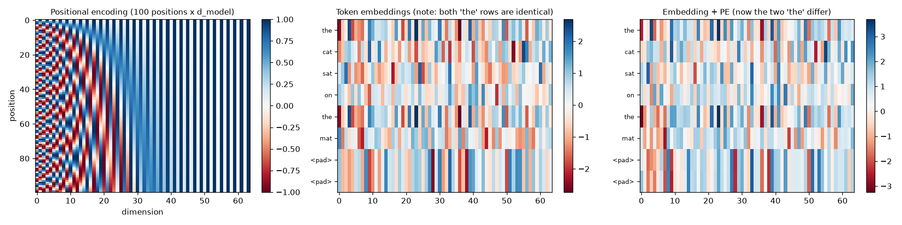

### 2. Scaled dot-product attention

$$\text{Attention}(Q, K, V) = \text{softmax}\left(\frac{QK^\top}{\sqrt{d_k}}\right)V$$

Each query is compared with every key. The softmax turns each row of scores into weights that sum to 1,
and the output is the weighted sum of the values.

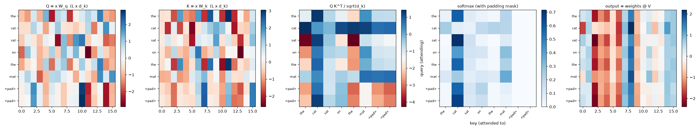

### 3. Padding mask

Sequences in a batch are padded to the same length. Masked positions get a score of −10⁹ before the
softmax, which gives them a weight of 0.

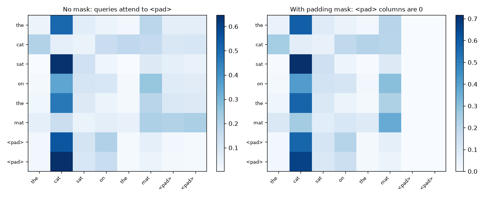

### 4. Multi-head attention

The model dimension is split into `h` heads of size `d_k = d_model / h`. Each head has its own
projections. The head outputs are concatenated and projected by `W_o`.

| Tensor | Shape |
|---|---|
| input `x` | `(B, L, d_model)` |
| `Q`, `K`, `V` after `split_heads` | `(B, H, L, d_k)` |
| attention weights | `(B, H, L_q, L_k)` |
| output after `merge_heads` and `W_o` | `(B, L, d_model)` |

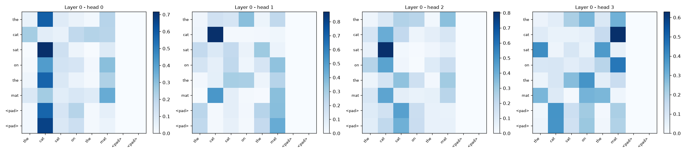

### 5. Encoder

An encoder layer has a self-attention sub-layer and a feed-forward sub-layer. Each is followed by a
residual connection and layer normalization (post-LN, as in the paper):

```
x = LayerNorm(x + Dropout(SelfAttention(x)))
x = LayerNorm(x + Dropout(FeedForward(x)))      # FeedForward: Linear(d_model, d_ff), ReLU, Linear(d_ff, d_model)
```

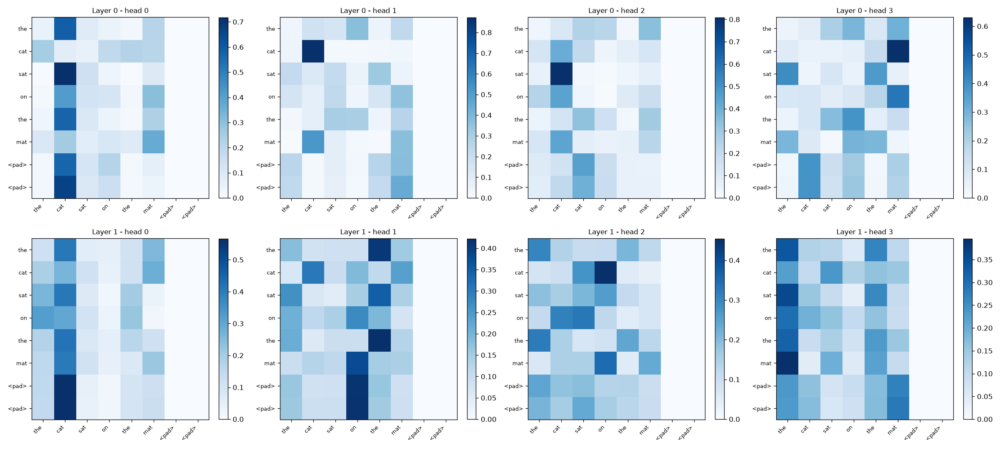

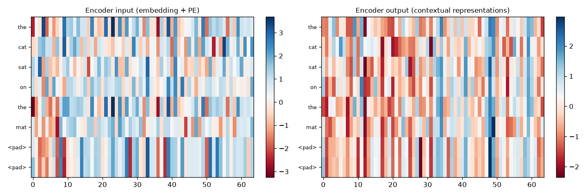

### 6. Decoder

A decoder layer has three sub-layers:

```
x = LayerNorm(x + Dropout(MaskedSelfAttention(x)))            # attends to earlier target positions
x = LayerNorm(x + Dropout(CrossAttention(x, encoder_out)))    # queries from the decoder, keys and values from the encoder
x = LayerNorm(x + Dropout(FeedForward(x)))
```

The decoder input is the target shifted right by one position (`<bos>` followed by `target[:-1]`). The
causal mask prevents position *i* from attending to positions after *i*. It is combined with the target
padding mask:

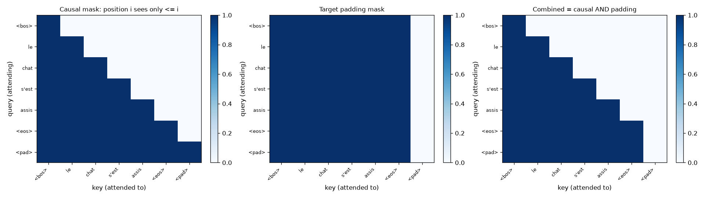

Masked self-attention weights. Weights above the diagonal are 0:

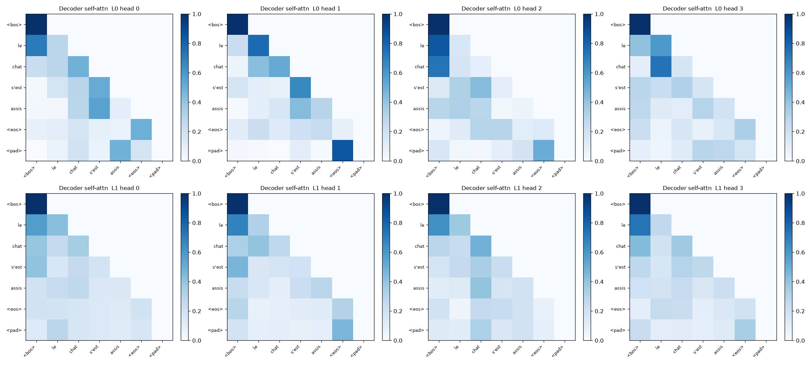

Cross-attention weights. Rows are target positions, columns are source positions. Source `<pad>`
columns are 0:

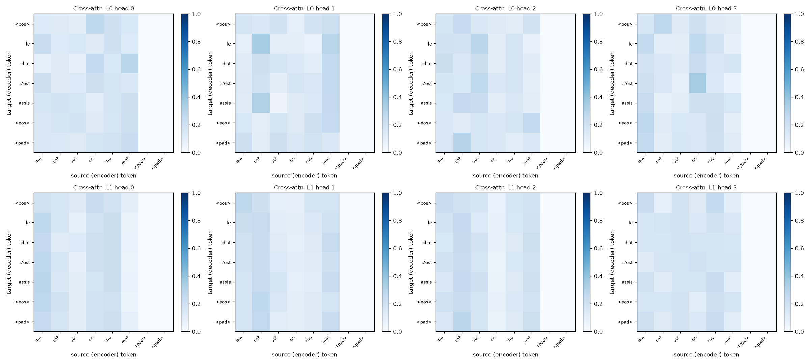

### 7. Output layer and parameter count

A linear layer maps each decoder output to one logit per vocabulary entry. For an untrained model the
output distribution is close to uniform, and the loss is close to ln(vocabulary size):

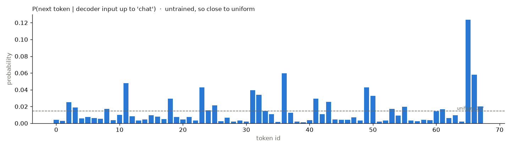

Parameters per module. An attention block has 4·d_model² + 4·d_model parameters and a feed-forward
block has 2·d_model·d_ff + d_ff + d_model:

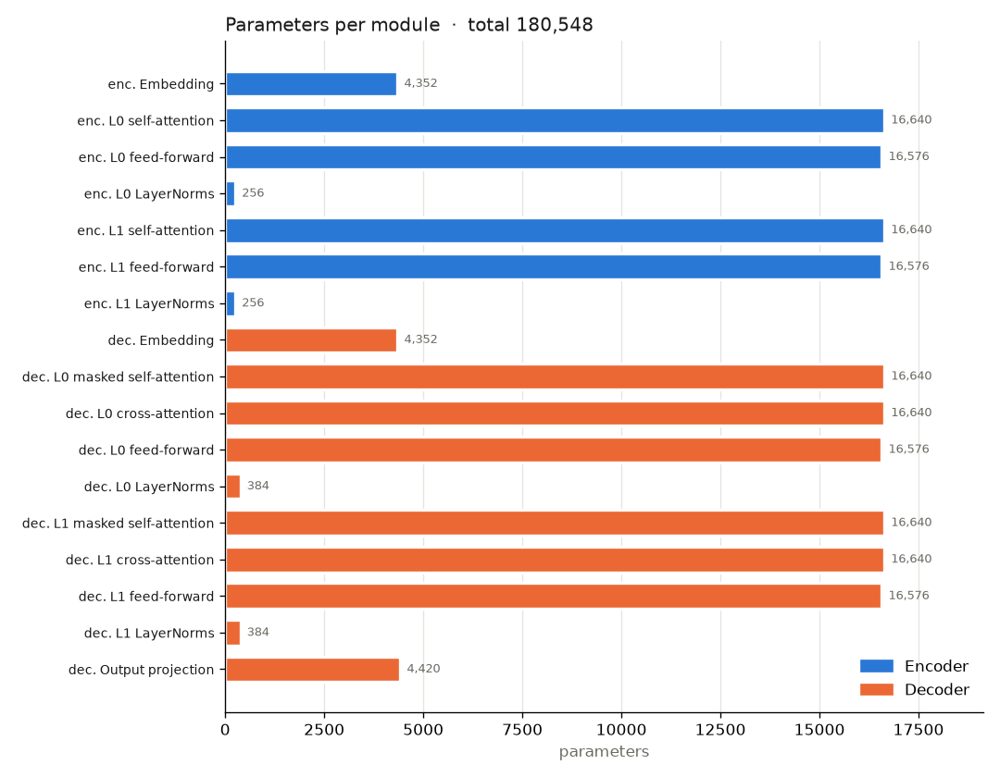

## Data and tokenizers

Tiny Shakespeare has 1,115,394 characters and 65 distinct characters. The model is an encoder-decoder,
so the text is split into consecutive chunks and each pair of neighbouring chunks is one example:

```
src     = chunk i                  encoder input
tgt_in  = <bos> + chunk i+1[:-1]   decoder input
tgt_out = chunk i+1                labels
```

Tokenizers measured on the full text (`uv run data.py`). The embedding column assumes `d_model = 128`.

| Tokenizer | Vocabulary | Tokens | Characters per token | Embedding parameters |
|---|---:|---:|---:|---:|
| character | 68 | 1,115,394 | 1.00 | 8.7k |
| byte | 259 | 1,115,394 | 1.00 | 33k |
| BPE trained on the text | 512 | 576,740 | 1.93 | 66k |
| BPE trained on the text | 1024 | 460,157 | 2.42 | 131k |
| BPE trained on the text | 2048 | 388,613 | 2.87 | 262k |
| BPE trained on the text | 4096 | 344,128 | 3.24 | 524k |
| GPT-2 BPE | 50,257 | | | 6.4M |

The character tokenizer is the default. A BPE tokenizer with 512 to 1024 tokens halves the sequence
length for a small increase in parameters. Larger vocabularies leave many tokens with few occurrences in
1 MB of text. All tokenizers use the special ids `<pad>=0`, `<bos>=1`, `<eos>=2`.

## Training details

Following section 5 of the paper:

- Loss: cross-entropy with label smoothing 0.1. Positions with a `<pad>` target are ignored.
- Optimizer: Adam with β₁ = 0.9, β₂ = 0.98, ε = 10⁻⁹. Gradients are also clipped to a global norm of
  1.0, which the paper does not do.
- Learning rate: linear warmup followed by inverse square root decay.

$$lrate = d_{model}^{-0.5} \cdot \min\left(step^{-0.5},\ step \cdot warmup^{-1.5}\right)$$

- Dropout 0.1 on the output of each sub-layer and on the sum of embeddings and positional encoding.
- One embedding matrix shared by the encoder input, the decoder input and the output layer
  (transposed), since source and target use the same vocabulary.

## Correctness checks

`uv run dummy_run.py` builds a model with d_model 128, 4 heads, d_ff 512, 2 encoder and 2 decoder layers
(934,400 parameters) and runs these checks. With `--quick` it stops before the training run.

| Check | Result |
|---|---|
| dataset size and MD5 match Karpathy's `input.txt` | pass |
| tokenizer round-trip, training pairs consistent | pass |
| output shapes; initial loss close to ln(68) | pass (4.50, ln(68) = 4.22) |
| changing later decoder inputs does not change earlier outputs (causal mask) | pass |
| adding `<pad>` tokens to the source does not change the outputs | pass (max difference 0.0) |
| dropout is off when `rng=None`, and reproducible for a given key | pass |
| embeddings are shared by encoder, decoder and output layer | pass |
| gradients are finite and non-zero for all 85 parameter tensors | pass |
| one batch is memorised (loss 4.56 to 0.0002) and greedy decoding reproduces it | pass |
| 1,500 training steps lower the validation loss (4.60 to 1.80) without NaNs | pass |

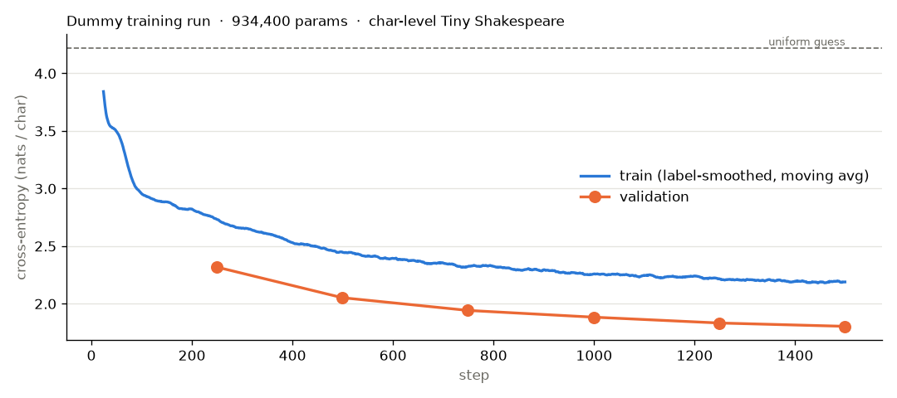

The training loss is computed with label smoothing and dropout, and the validation loss without them,
which is why the training curve is higher.

Text generated after the 1,500 steps, from a validation prompt, with temperature 0.8:

```
 will many hevigh his lives we was it mine,
This kill battering  says and his world fOx hape
I end Duke in and put upopity. Bet  thou say say bed.

FLORIZEL:
O, I know a prossent brip expoAters, in alpeous.
I parthen Haster heard man for his of your sjurte
```

## Implementation notes

- Each class (`MultiHeadAttention`, `EncoderLayer`, `Transformer`, ...) stores only hyperparameters.
  `init(key)` returns the parameters as a dict, and `__call__(params, ...)` is a pure function, so
  `jax.jit` and `jax.grad` can be applied directly.
- Dropout is applied when an `rng` key is passed and skipped when `rng` is `None`.
- In masks, `True` means the position can be attended to. Padding masks have shape `(B, 1, 1, L)` and the
  causal mask has shape `(1, 1, L, L)`.
- `Transformer.generate` runs the encoder once, then the decoder once per output token inside
  `lax.fori_loop`. It uses greedy decoding by default and sampling when a temperature and key are given.
- The decoder is trained on targets of `block` tokens, so it has only seen positions `0` to `block - 1`.
  `generate.py` produces longer text one chunk at a time, using each generated chunk as the next encoder
  input.

## References

- Vaswani et al., [Attention Is All You Need](https://arxiv.org/abs/1706.03762), NeurIPS 2017.
- Rush, [The Annotated Transformer](https://nlp.seas.harvard.edu/annotated-transformer/).
- Karpathy, [char-rnn](https://github.com/karpathy/char-rnn), source of the Tiny Shakespeare dataset.
